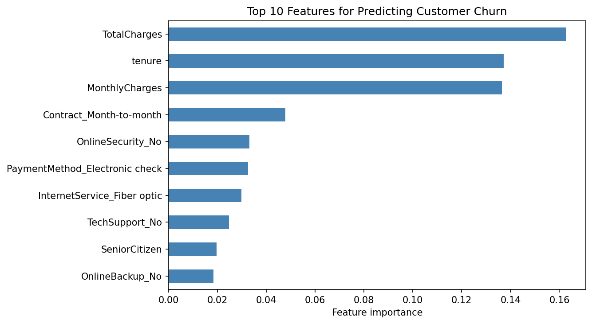

# Customer Churn Prediction

TRAINLYZE Machine Learning Internship | Task 3, Project 1

## Project Overview

Customer churn means a customer stops using a service. In this project, I trained a Random Forest model to predict whether a telecom customer would leave or stay based on details such as contract type, tenure, and monthly charges.

## Dataset and Tools

I used the IBM Telco Customer Churn dataset, which contains 7,043 customer records. I built the project in Google Colab using Python, pandas, scikit-learn, and Matplotlib.

## Method

1. Converted total charges to numbers and removed the customer ID from the model inputs.
2. Split the data into 5,634 training customers and 1,409 testing customers.
3. Filled missing charges using the training median and converted text categories into numerical inputs.
4. Trained a Random Forest classifier with 100 trees.
5. Evaluated the predictions using test accuracy and a confusion matrix.

## Results

| Metric | Result |
| --- | --- |
| Test accuracy | 77.79% |
| Out-of-bag accuracy | 78.86% |
| Customers who left in the test set | 374 |
| Correctly predicted to leave | 178 |
| Missed by the model | 196 |

The model correctly identified 47.59% of the customers who left. Total charges was the most important feature, followed by tenure and monthly charges.

## How to Run

1. Open `Customer_Churn_Prediction.ipynb` in Google Colab.
2. Select **Runtime → Run all**.
3. View the confusion matrix, feature importance chart, and sample customer prediction.
